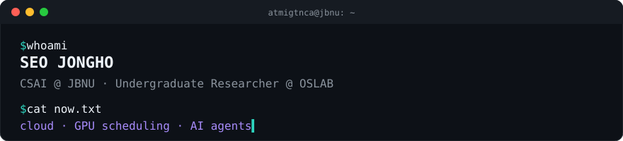

Interested in **Cloud Computing** & **LLM Inference Optimization**.  
Crew at [@ZEROONE](https://github.com/zeroone-2025) · [mail](mailto:whdgh9173@jbnu.ac.kr)

### 🚀 Recent Projects

**JCloud** — campus private cloud, rebuilt on OpenStack Gazpacho with Ceph in summer 2026; now adding an AI agent to monitoring for automated reports  
`OpenStack` `Kolla-Ansible` `Ceph` `Prometheus` `Grafana` `Linux` `Networking`

**JPUShare** — GPU sharing for research labs: Apptainer jobs on Slurm, with GPU scheduling by lab-level fair-share credits and automatic GPU placement  
`Slurm` `Apptainer`

**dobi-superagent** *(in development)* — an all-in-one personal agent that commands a legion of AI agents to do anything I can imagine, built on Hermes Agent  
`Hermes Agent` `Pi Agent`

**Side** — AWS Networking · CNCF Kubestronaut · LLM Jailbreaking
